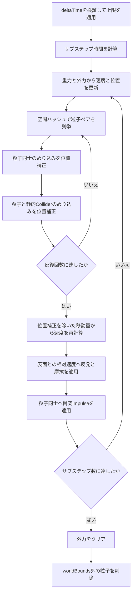

# ParticleWorld 実装解説

## 1. この資料の目的

`LGF::Physics::ParticleWorld`は、球形の物理粒子を扱う簡易的な3D物理シミュレーターです。
この資料では、ParticleWorldを使用する方法だけでなく、内部でどのような計算を行っているかを説明します。

主な機能は次のとおりです。

- 重力、外力、力積による粒子の移動
- 球形粒子同士の衝突
- 粒子と静的なSphere、SphericalCap、SphericalShellCap、AABBコライダーとの衝突
- 反発と摩擦
- 空間ハッシュによる粒子同士の衝突候補の絞り込み
- AABBで指定したワールド範囲外の粒子の自動削除
- 世代番号付きハンドルによる安全な粒子とコライダーの参照

実装は次のファイルに分かれています。

- 公開API: [`Project/Include/LGF/Physics/ParticleWorld.h`](../Project/Include/LGF/Physics/ParticleWorld.h)
- 内部実装: [`Project/Src/Physics/ParticleWorld.cpp`](../Project/Src/Physics/ParticleWorld.cpp)
- 確認シーン: [`ParticleWorldScene.cpp`](../../../Project/Src/Scene/ParticleWorldScene.cpp)

## 2. ParticleWorldの立ち位置

ParticleWorldが扱う粒子は、それぞれが位置、速度、半径、質量を持つ球体です。
煙や火花のように見た目だけを動かすパーティクルではなく、衝突して押し合う物理オブジェクトとして扱います。

ただし、一般的な剛体物理エンジンをすべて再現したものではありません。
粒子には回転、角速度、姿勢がなく、形状もSphereに限定しています。
形状を限定することで、粒子を多数扱う場合でも実装と計算量を比較的単純に保っています。

現在のアルゴリズムは、純粋なPBDだけで構成されているわけではありません。
めり込みの解消には位置ベースの補正を使い、反発と摩擦には速度ベースの処理を使っています。
この資料では、この方式を「位置補正と速度応答のハイブリッド」と呼びます。

## 3. 公開データの構成

### 3.1 ParticleDesc

粒子を追加するときに指定する値です。

| メンバー | 意味 |
|---|---|
| `position` | 粒子中心の初期位置 |
| `velocity` | 初速度 |
| `radius` | Sphereコライダーの半径 |
| `mass` | 質量。`0`の場合は固定粒子 |
| `collisionParameter` | 反発係数と摩擦係数 |
| `enabled` | シミュレーションへ参加するか |
| `userData` | ゲーム側が自由に使える識別値 |

内部では質量そのものではなく、逆質量を保存します。

```text
inverseMass = 1 / mass
```

質量が`0`の場合は逆質量も`0`になります。
力や位置補正へ逆質量を掛けることで、固定粒子を特別な分岐の少ない形で扱えます。

### 3.2 CollisionParameter

```cpp
struct CollisionParameter {
    float restitution = 0.1f;
    float friction = 0.4f;
};
```

`restitution`は反発係数です。`0`に近いほど跳ねず、`1`に近いほど速度を保って跳ね返ります。

`friction`は摩擦係数です。`0`では接線方向の速度をほとんど失わず、`1`へ近づけるほど滑りにくくなります。

ParticleWorldへ渡された値は`0`から`1`の範囲に収められます。
粒子とコライダーが接触したときは、次の方法で両者の値を合成します。

```text
反発係数 = max(粒子の反発係数, コライダーの反発係数)
摩擦係数 = sqrt(粒子の摩擦係数 × コライダーの摩擦係数)
```

反発には大きい方を使用するため、どちらか一方がよく跳ねる設定なら接触全体も跳ねやすくなります。
摩擦には幾何平均を使用し、片方だけが極端な値でも変化が急になりすぎないようにしています。

### 3.3 ParticleWorldSettings

| メンバー | 意味 |
|---|---|
| `gravity` | すべての動的粒子へ加える重力加速度 |
| `worldBounds` | 粒子を生存させるAABB範囲 |
| `substepCount` | 1フレームを分割して計算する回数 |
| `solverIterationCount` | 1サブステップ中に位置補正を繰り返す回数 |
| `linearDamping` | 速度の減衰量 |
| `penetrationSlop` | 補正せずに許容する小さなめり込み量 |
| `positionCorrectionRate` | 1反復で解消するめり込みの割合 |
| `maximumDepenetrationVelocity` | めり込み解消で許可する最大押し出し速度 |
| `bounceVelocityThreshold` | 反発係数を適用する最低衝突速度 |
| `maximumDeltaTime` | 1フレームで受け付ける最大経過時間 |

`substepCount`と`solverIterationCount`は似ていますが、役割が異なります。

- サブステップは時間そのものを細かく分割します。
- ソルバー反復は同じ時刻のめり込み補正を繰り返します。

高速な粒子のすり抜けを減らしたい場合は、主に`substepCount`を増やします。
多数の粒子が積み重なったときの押し合いを安定させたい場合は、主に`solverIterationCount`を増やします。
どちらも増やすほど処理負荷が上がります。

### 3.4 ParticleWorldStepStatistics

`GetLastStepStatistics()`から、直前に実行した`Step()`の処理時間と衝突候補数を取得できます。

| メンバー | 意味 |
|---|---|
| `totalMilliseconds` | `Step()`全体の処理時間 |
| `integrationMilliseconds` | 重力と外力から速度、予測位置を更新した時間 |
| `broadPhaseMilliseconds` | 空間ハッシュを構築して候補ペアを作成した時間 |
| `positionSolveMilliseconds` | 粒子同士と静的コライダーのめり込みを解消した時間 |
| `velocitySolveMilliseconds` | 速度の復元、反発、摩擦を計算した時間 |
| `cleanupMilliseconds` | 外力の消去、範囲外粒子の削除、コライダー形状の保存に使った時間 |
| `candidatePairCount` | 全サブステップで生成した粒子ペア候補数の合計 |

```cpp
world.Step(deltaTime);

const auto& statistics = world.GetLastStepStatistics();
std::cout << statistics.totalMilliseconds << " ms\n";
std::cout << statistics.candidatePairCount << " pairs\n";
```

各区間は個別に計測しているため、それらの合計と`totalMilliseconds`は完全には一致しません。
コライダーの補間、作業配列の準備、計測自体の負荷などが全体時間にだけ含まれます。

### 3.5 StaticCollider

ParticleWorldへ登録できる静的コライダーは、現在Sphere、SphericalCap、SphericalShellCap、AABBです。

```cpp
using StaticColliderShape = std::variant<
    Collision::Sphere,
    Collision::SphericalCap,
    Collision::SphericalShellCap,
    Collision::AABB>;
```

`SphericalCap`は円形の境界を持つ、閉じていない球面です。
`apex`を球面の頂点、`axis`を頂点から円形境界へ向かう軸として、
`baseRadius`と`height`で曲面の広さと深さを指定します。
円形境界を塞ぐ面はないため、粒子は開口部を通過できます。

`SphericalShellCap`は同心の内側球面と外側球面に、開口部の環状面を加えた厚みのある形状です。
内側からは器として粒子を受け止め、外側から接触した粒子も外側へ押し返します。
`outerApex`、`axis`、`outerRadius`、`innerRadius`、`height`で形を指定します。

静的コライダーは質量を持たず、粒子から押されても動きません。
`StaticColliderOptions`によって、反発、摩擦、有効状態、ユーザーデータを設定できます。

## 4. 基本的な使い方

次の例では、有限のシミュレーション範囲、床、球形の障害物、落下する粒子を作成しています。

```cpp
LGF::Physics::ParticleWorld world({
    .gravity = { 0.0f, -9.8f, 0.0f },
    .worldBounds = {
        .min = { -20.0f, -10.0f, -20.0f },
        .max = { 20.0f, 20.0f, 20.0f },
    },
    .substepCount = 4,
    .solverIterationCount = 6,
});

world.AddCollider(
    LGF::Collision::AABB{
        .min = { -5.0f, -0.5f, -5.0f },
        .max = { 5.0f, 0.0f, 5.0f },
    },
    LGF::Physics::StaticColliderOptions{
        .collisionParameter = {
            .restitution = 0.1f,
            .friction = 0.8f,
        },
    });

world.AddCollider(LGF::Collision::Sphere{
    .center = { 0.0f, 1.0f, 0.0f },
    .radius = 1.0f,
});

const LGF::Physics::ParticleHandle particle = world.Add({
    .position = { 0.0f, 5.0f, 0.0f },
    .velocity = {},
    .radius = 0.2f,
    .mass = 1.0f,
    .collisionParameter = {
        .restitution = 0.25f,
        .friction = 0.4f,
    },
});

world.Step(static_cast<float>(LGF::System::DeltaTime()));
```

描画時は`GetStates()`で有効な粒子の状態を取得します。

```cpp
std::vector<LGF::Physics::ParticleState> states;
world.GetStates(states);

for (const auto& state : states) {
    LGF::Sphere3D(state.radius).Draw(
        LGF::Math::MakeTranslateMatrix(state.position),
        LGF::Color::Gold);
}
```

ParticleWorldは物理計算だけを担当し、描画オブジェクトを所有しません。
この分離によって、同じ物理粒子を球、モデル、インスタンシングなど任意の方法で描画できます。

## 5. 1フレームの処理順

`Step(deltaTime)`は、概ね次の順番で処理します。



以下の章で各処理を詳しく説明します。

## 6. 時間の分割

フレーム時間が極端に大きいと、1回の移動距離も大きくなり、衝突面を飛び越えやすくなります。
そこで、最初にフレーム時間へ上限を設定します。

```text
frameTime = min(deltaTime, maximumDeltaTime)
substepTime = frameTime / substepCount
```

例えば、1フレームが`1 / 60`秒で`substepCount = 4`なら、物理計算は約`1 / 240`秒ずつ4回行われます。

この方式には、長時間停止した後に大量の遅れを一度に計算しない利点もあります。
一方で、`maximumDeltaTime`を超えた時間は物理シミュレーション上では失われます。

## 7. 重力、外力、力積

### 7.1 重力と外力

各サブステップで、加速度を次のように求めます。

```text
acceleration = gravity + force × inverseMass
```

その後、速度と位置を更新します。

```text
velocity += acceleration × substepTime
position += velocity × substepTime
```

更新後の速度を使って位置を進めるため、これは半陰的オイラー法に近い計算です。
明示的オイラー法よりも、重力やばねのような加速度を扱うときに安定しやすい特徴があります。

`AddForce()`で追加した力は1回の`Step()`が終わるとクリアされます。
継続して力を加えたい場合は毎フレーム呼び出します。

### 7.2 力積

`AddImpulse()`は、時間積分を待たずに速度を直接変更します。

```text
velocity += impulse × inverseMass
```

一瞬だけ粒子を打ち上げる、爆発で吹き飛ばす、といった処理に向いています。

## 8. 粒子同士の衝突候補を探す

すべての粒子ペアを調べる単純な方法では、粒子数を`N`とすると最大でおよそ`N² / 2`回の判定が必要です。
粒子が増えるほど急激に処理が重くなるため、ParticleWorldでは一様グリッドによる空間ハッシュを使っています。

### 8.1 セルサイズ

セルサイズは、有効な粒子の最大直径から決めます。

```text
cellSize = maximumParticleRadius × 2
```

粒子の位置をセルサイズで割り、切り下げることで整数のセル座標へ変換します。

```text
cell.x = floor(position.x / cellSize)
cell.y = floor(position.y / cellSize)
cell.z = floor(position.z / cellSize)
```

負の座標でも正しいセルへ入るように、整数キャストではなく`floor()`を使用しています。

### 8.2 近傍セル

ある粒子と衝突する可能性がある粒子は、自分のセルと周囲のセルに存在します。
3Dでは各軸について`-1`、`0`、`1`を調べるため、最大27セルを参照します。

同じペアを二重に処理しないよう、相手の配列インデックスが自分より大きい場合だけ判定します。

```text
secondIndex > firstIndex
```

粒子が空間へ適度に分散している場合、全ペア判定より少ない候補だけを調べられます。
すべての粒子が狭い場所へ密集した場合は、最悪計算量が再び`O(N²)`へ近づきます。

## 9. 粒子同士の位置補正

2つの粒子を、それぞれ中心`x1`、`x2`、半径`r1`、`r2`とします。

```text
delta = x2 - x1
distance = length(delta)
minimumDistance = r1 + r2
penetration = minimumDistance - distance
```

`penetration`が正なら、2つのSphereが重なっています。
接触法線は1つ目の粒子から2つ目の粒子へ向かう方向です。

```text
normal = normalize(delta)
```

小さなめり込みを許容し、1反復で直す量と最大押し出し量を計算します。

```text
effectivePenetration = max(penetration - penetrationSlop, 0)
maximumCorrectionPerIteration =
    maximumDepenetrationVelocity
    × substepTime
    / solverIterationCount
correctionDepth = min(
    effectivePenetration × positionCorrectionRate,
    maximumCorrectionPerIteration)

inverseMassSum = inverseMass1 + inverseMass2
correction = normal × correctionDepth / inverseMassSum

x1 -= correction × inverseMass1
x2 += correction × inverseMass2
```

`penetrationSlop`以下の重なりを無理に解消しないことで、接触面付近の細かい振動を抑えます。
`positionCorrectionRate`は、1反復で解消する割合です。全量を一度に直さず、反復しながら徐々に収束させます。
`maximumDepenetrationVelocity`は深いめり込みを一気に直すことを防ぐ上限で、サブステップ時間と反復回数から1反復あたりの最大補正距離へ変換します。

軽い粒子は大きく移動し、重い粒子は小さく移動します。
片方の質量が`0`なら逆質量も`0`なので、その粒子は移動せず、もう片方だけが補正されます。

複数の粒子が積み重なると、1つの衝突を直した結果として別の粒子へ再びめり込むことがあります。
そのため、この処理を`solverIterationCount`回繰り返します。

## 10. 静的コライダーとの位置補正

静的コライダーは粒子から押されないため、位置補正は粒子側だけへ適用します。

```text
effectivePenetration = max(penetrationDepth - penetrationSlop, 0)
correctionDepth = min(
    effectivePenetration × positionCorrectionRate,
    maximumCorrectionPerIteration)
particlePosition += contactNormal × correctionDepth
```

ここで使う接触法線は、静的コライダーとの重なりを解消し、
粒子をコライダーの有効領域へ戻す方向です。

### 10.1 Sphereとの接触

粒子と静的Sphereの中心間距離を求めます。

```text
minimumDistance = particleRadius + colliderRadius
penetrationDepth = minimumDistance - centerDistance
```

中心間距離が半径の合計より小さければ接触しています。
中心が完全に一致して法線を計算できない場合は、ゼロ除算を避けるため上方向を代替法線として使います。

### 10.2 AABBとの接触

粒子中心に対するAABB上の最近接点を、各成分の`clamp()`で求めます。

```text
closest.x = clamp(center.x, box.min.x, box.max.x)
closest.y = clamp(center.y, box.min.y, box.max.y)
closest.z = clamp(center.z, box.min.z, box.max.z)
```

粒子中心と最近接点の距離が粒子半径以下なら接触しています。

粒子中心がAABB内部へ完全に入っている場合、最近接点と中心が同じになり、通常の方法では押し出す方向を求められません。
その場合は、AABBの6面までの距離を比較し、最も近い面の外側へ粒子を押し出します。

この内部判定がないと、高速移動などで粒子中心が箱の中へ入った際に、粒子が箱内部へ残る可能性があります。

### 10.3 SphericalCapとの接触

SphericalCapの`baseRadius`を`a`、`height`を`h`とすると、
元になる球の半径`R`は次の式で求められます。

```text
R = (a² + h²) / (2h)
```

元の球の中心は`apex + normalize(axis) × R`です。
粒子中心から元の球の中心へ向かう方向を使って球面上の点を求め、
その点が`apex`から`height`までの範囲にある場合だけ接触候補にします。
これにより、円形境界より先にある開口部は衝突面になりません。

ParticleWorldでは球冠の内側を有効領域として扱います。
粒子の外周が元の球面を越えた量だけ、元の球の中心方向へ位置を戻します。
描画用の`SphericalCap3D`も同じ`baseRadius`と`height`を使うため、
両者へ同じ値を渡すと見た目と衝突面を一致させられます。

### 10.4 SphericalShellCapとの接触

SphericalShellCapは、同じ球中心を持つ半径`outerRadius`と`innerRadius`の2つの球面を使います。
`outerApex`から`axis`方向へ`height`進んだ位置を共通の開口平面とし、次の3面で厚みのある境界を作ります。

- 内側の球面
- 外側の球面
- 開口部にある環状面

粒子中心から3面それぞれの最近接点を求め、距離が最も短い点を接触点として使います。
粒子中心が殻の材質内にある場合は、最も近い境界を越えるまで押し出します。
材質外から球が表面へ重なった場合は、侵入してきた側へ押し返します。
この処理により、器の内側、底面の外側、縁のどこから接触しても同じ形状で判定できます。

形状を成立させるには次の関係が必要です。

```text
outerRadius > innerRadius > 0
outerRadius - innerRadius < height <= outerRadius
```

`outerRadius - innerRadius`は殻の厚みです。`height`が厚み以下になると内側球面が開口平面まで届かないため、無効な形状として扱います。

## 11. 補正後の速度

位置補正によって粒子を大きく動かし、その移動量をそのまま速度へ変換すると、深く埋まった粒子が異常な速度で吹き飛ぶ原因になります。
例えば0.5mの補正を`1 / 480`秒のサブステップで速度へ変換すると、補正だけで240m/sになります。

ParticleWorldでは、粒子同士と静的コライダーによって加えた位置補正を`positionCorrections`へ記録します。
速度を作り直すときは、この補正量を実際の移動量から除外します。

```text
physicalMovement =
    correctedPosition
    - previousPosition
    - positionCorrection

velocity = physicalMovement / substepTime
```

この方法は、めり込み解消用の位置移動と物理的な速度変化を分離する、Split Impulseに近い考え方です。
位置は安全な場所へ戻しますが、その補正距離から新しい運動エネルギーを作りません。

続いて、指数関数を使った線形減衰を適用します。

```text
damping = exp(-linearDamping × substepTime)
velocity *= damping
```

フレームごとに一定値を引く方法よりも、経過時間が変化したときに結果を揃えやすい計算です。

## 12. 静的コライダーへの反発と摩擦

`SetColliderShape()`で静的コライダーを移動した場合は、前回と現在の基準位置から線形速度を求めます。

```text
surfaceVelocity =
    (currentColliderPosition - previousColliderPosition)
    / frameTime
```

Sphereでは`center`、SphericalCapでは`apex`、SphericalShellCapでは`outerApex`、AABBでは中心を基準位置として使います。
粒子速度から表面速度を引き、コライダーから見た相対速度を作ります。

```text
relativeVelocity = particleVelocity - surfaceVelocity
normalSpeed = dot(relativeVelocity, normal)
normalVelocity = normal × normalSpeed
tangentVelocity = relativeVelocity - normalVelocity
```

`normalSpeed < 0`の場合、粒子と表面が接近しています。
衝突速度が`bounceVelocityThreshold`を超える場合だけ反発係数を使います。
しきい値以下の低速接触では反発係数を`0`として、表面へ向かう速度だけを消します。

```text
appliedRestitution =
    -normalSpeed > bounceVelocityThreshold
    ? restitution
    : 0

particleVelocity = surfaceVelocity
    + tangentVelocity × (1 - friction)
    - normalVelocity × appliedRestitution
```

- 法線方向の速度は向きを反転し、反発係数を掛けます。
- 接線方向の速度は摩擦係数に応じて減らします。
- 低速接触では跳ね返さず、静止直前の細かいバウンドを抑えます。
- 最後に表面速度を戻すため、動く器が粒子を運ぶ速度は失われません。

複数の静的コライダーへ同時に接触した場合は、接触法線を加算してから正規化します。
角へ接触した場合は、複数面の中間方向へ押し返す法線になります。

## 13. 粒子同士の速度応答

位置補正後、粒子同士には力積による速度応答も行います。
2つ目から1つ目を見た相対速度ではなく、実装では次の相対速度を使います。

```text
relativeVelocity = velocity2 - velocity1
normalSpeed = dot(relativeVelocity, normal)
```

`normalSpeed`が負なら、2つの粒子は接近しています。
静的コライダーと同じく、接近速度が`bounceVelocityThreshold`以下なら反発係数を`0`として、低速時の跳ね続けを防ぎます。
法線方向へ加える力積の大きさは次の式です。

```text
normalImpulseMagnitude =
    -(1 + restitution) × normalSpeed
    / (inverseMass1 + inverseMass2)
```

この力積を逆向きにそれぞれの粒子へ適用します。

```text
velocity1 -= normalImpulse × inverseMass1
velocity2 += normalImpulse × inverseMass2
```

摩擦については、相対速度から法線方向を除いた接線速度を求めます。
接線方向の力積は、接線速度を打ち消す量と、摩擦係数から求めた上限の小さい方に制限します。

```text
tangentImpulseMagnitude = min(
    tangentSpeed / inverseMassSum,
    friction × normalImpulseMagnitude)
```

これはクーロン摩擦を簡略化した考え方です。

## 14. worldBoundsによる自動削除

物理粒子は、床の外へ落ちても何もしなければ重力で落下し続けます。
描画されなくなった粒子も計算対象として残るため、長時間のゲームでは不要な処理とメモリ使用が増えていきます。

ParticleWorldでは`Step()`の最後に、粒子中心が`worldBounds`の内側にあるか確認します。

```cpp
if (!Collision::Contains(settings.worldBounds, particle.position)) {
    RemoveParticleAt(index);
}
```

判定対象はSphere全体ではなく粒子の中心です。
中心がAABBを出たフレームで粒子が削除されます。

削除された粒子のスロットはフリーリストへ追加され、後から追加される粒子に再利用されます。

## 15. 世代番号付きハンドル

ParticleWorldは粒子へのポインターを外部へ公開せず、`ParticleHandle`を返します。

```cpp
struct ParticleHandle {
    uint32_t index;
    uint32_t generation;
};
```

`index`は内部配列の位置です。
粒子を削除すると、そのスロットの`generation`を増加させます。

例えば、インデックス`5`の粒子Aを削除し、同じスロットへ粒子Bを追加した場合でも、AとBでは世代番号が異なります。
古いAのハンドルを使ってBを誤操作することを防げます。

```text
粒子A: index = 5, generation = 1
削除後
粒子B: index = 5, generation = 2
```

`worldBounds`によって自動削除された場合も同じ処理を通るため、以前のハンドルは`IsValid()`で無効になります。

静的コライダーの`StaticColliderHandle`も同じ仕組みです。

## 16. パラメータ調整の目安

### 粒子が床をすり抜ける

まず`substepCount`を増やします。
粒子の1サブステップあたりの移動距離を小さくすることが目的です。

```cpp
.substepCount = 4,
```

現在は連続衝突判定を行っていないため、速度が非常に大きい場合はサブステップを増やしても完全には防げません。

### 積み重なった粒子が震える、沈み込む

`solverIterationCount`を増やします。

```cpp
.solverIterationCount = 6,
```

反復回数を増やすと複数接触の位置補正が収束しやすくなります。

### 深く埋まった粒子を早く戻したい

`maximumDepenetrationVelocity`を大きくすると、1フレームで許可される位置補正量が増えます。
ただし、大きくしすぎると重なった粒子が急に離れ、見た目が不安定になる可能性があります。

`positionCorrectionRate`を大きくすると浅いめり込みの収束も速くなります。
まず`0.2`前後から調整し、必要な場合だけ`maximumDepenetrationVelocity`を上げるのがおすすめです。

接触面付近で震える場合は、`penetrationSlop`を少し大きくします。
大きくしすぎると目に見える重なりを許すことになるため、粒子半径より十分小さい値にします。

### 静止直前に細かく跳ね続ける

`bounceVelocityThreshold`を大きくすると、低速衝突で反発係数が使われなくなります。
高速な落下では跳ね、静止直前だけ跳ねなくするには、`0.5`から`1.0`程度を基準に調整します。

### 粒子がいつまでも動き続ける

`linearDamping`か摩擦を大きくします。

- 空中も含めて減速させたい場合は`linearDamping`
- 床や粒子へ接触したときだけ減速させたい場合は`friction`

### 粒子を軽く見せたい

同じ重力だけを受ける場合、質量を変えても落下加速度は変わりません。
質量の違いは、外力、力積、粒子同士の押し合いに現れます。

軽い見た目にしたい場合は、反発、減衰、半径、加える力積も合わせて調整します。

## 17. 計算量

粒子数を`N`、静的コライダー数を`M`、ソルバー反復回数を`I`とします。

- 空間ハッシュと粒子同士の候補ペアは、各サブステップの予測位置から1回だけ作成します。
- 作成した候補ペアは、すべての位置補正反復と速度解決で再利用します。
- 粒子同士の候補探索は、分散時にはおおむね`O(N)`に近づきます。
- 粒子が密集した最悪時には`O(N²)`へ近づきます。
- 静的コライダー判定は現在、各粒子から全コライダーを見るため`O(N × M)`です。
- 候補ペアと静的コライダーの位置補正を`I`回繰り返します。
- さらに全体を`substepCount`回実行します。

静的コライダーが増えた場合は、コライダー側にもBVH、グリッド、AABBツリーなどの広域判定を導入する余地があります。

## 18. 現在の制限

ParticleWorldは学習しやすさと汎用的な土台を優先した簡易実装です。
現在は次の機能を持っていません。

- 連続衝突判定
- 粒子の回転、角速度、トルク
- Sphere以外の動的粒子
- 動的剛体
- 回転・変形を含む静的コライダーの接触点ごとの表面速度
- スリープ処理
- 衝突レイヤーとマスク
- 衝突イベント
- 静的コライダー用の広域判定
- 流体の圧力、密度、粘性、表面張力

`SetColliderShape()`を使えば静的コライダーの位置や大きさは更新できます。
ParticleWorldは前回と現在の形状を保存し、各サブステップで線形補間した形状を衝突判定に使います。
このため、1フレーム内で適度に移動するコライダーは、現在位置だけで判定する場合よりすり抜けにくくなります。
平行移動については、前回と現在の基準位置から線形速度を計算し、反発と摩擦へ使用します。
ただし、回転の補間、厳密な連続衝突判定、回転や変形による接触点ごとの表面速度計算は行っていません。
非常に大きな瞬間移動ではすり抜ける可能性があるため、必要に応じて`substepCount`を増やしてください。

## 19. 中華鍋へ発展させる場合

今回のParticleWorldは、炒飯を構成する多数の粒を動かす基礎になります。
中華鍋を振った動きを粒子へ正しく伝えるには、次の拡張が考えられます。

現在はコライダーの前回形状と現在形状を保存し、サブステップごとに補間しています。
さらに平行移動の速度を求め、粒子との相対速度を使って反発と摩擦を計算しています。
さらに鍋を振った動きを粒子へ正確に伝えるには、次の拡張が考えられます。

1. 回転するコライダーの姿勢を補間する。
2. 角速度から接触点ごとの表面速度を計算する。
3. 変形する形状の表面速度を計算する。
4. 必要に応じて連続衝突判定を追加する。

炒飯らしいまとまりを追加する場合は、次の順番で拡張すると挙動を確認しやすくなります。

1. 粒子半径のばらつき
2. 粒子間摩擦の調整
3. 弱い凝集力
4. 粘性
5. 必要になった段階で密度と圧力

いきなり流体シミュレーションへ置き換えず、必要な見た目に応じて力を追加していく方が、ゲーム向けには制御しやすい場合があります。

## 20. 実装を読み進める順番

初めてソースコードを読む場合は、次の順番がおすすめです。

1. `ParticleWorldSettings`と`ParticleDesc`で入力データを確認する。
2. `ParticleWorld::Add()`で内部スロットへの保存方法を見る。
3. `ParticleWorld::Step()`の外側から、サブステップの構造を追う。
4. 重力による積分処理を見る。
5. `buildParticlePairs`で空間ハッシュと候補ペアの作り方を見る。
6. 粒子同士の位置補正を見る。
7. `FindContact()`でSphere、SphericalCap、SphericalShellCap、AABBとの接触計算を見る。
8. 補正後の速度再計算と反発処理を見る。
9. `RemoveParticleAt()`でハンドルの世代更新を見る。

一度にすべてを理解しようとせず、粒子1個と床1個から追い始めると計算の流れを確認しやすくなります。

## 21. 学習用の改造課題

実装を理解するための小さな課題です。

1. 重力を横向きにして、粒子が壁へ落ちる様子を確認する。
2. 床と粒子の反発係数を変え、合成結果を比較する。
3. `substepCount`を`1`と`8`で比較し、高速粒子の挙動を見る。
4. `solverIterationCount`を変え、粒子の積み重なり方を比較する。
5. Sphereコライダーを追加し、粒子が曲面から滑り落ちる様子を見る。
6. SphericalCapの`baseRadius`と`height`を変え、曲率の違いを比較する。
7. SphericalShellCapを移動し、`substepCount`によるすり抜け方の違いを比較する。
8. `worldBounds`を狭くし、ハンドルが自動的に無効になることを確認する。
9. 静的コライダー用の空間ハッシュを追加する。
10. 接触回数や最大速度をImGuiへ表示する。

確認シーンでは`E`で粒子を追加し、`T`で粒子を散らせます。
黄色いワイヤーフレームが`worldBounds`で、外へ出た粒子は自動的に削除されます。

`SphericalShellCapScene`では、左ドラッグで器をXZ平面上へ、マウスホイールで上下へ動かせます。
`A`で自動往復を開始すると、移動する静的コライダーに粒子が追従する様子と、すり抜け数を確認できます。
